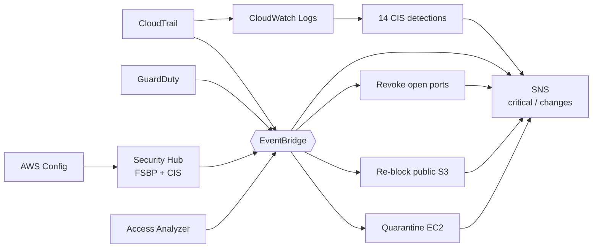

# AWS Security Guardrails: Detection & Auto-Remediation

[](https://github.com/Monkmode-tech/aws-security-guardrails-detection/actions/workflows/ci.yml)


**Roles this project supports:** Cloud Security Engineer · Security Engineer · Cloud Engineer · Solutions Architect

## In plain terms (2-minute read)

**The problem.** Most cloud breaches don't start with clever hacking. They start
with a simple mistake that nobody notices: a server port left open to the whole
internet, a storage bucket made public, or someone quietly switching off the
audit log. Companies need to *see* these mistakes immediately and, where it's
safe, *fix them automatically*.

**What I built.** A security system for an AWS account, written as code, that
works like a building's alarm, cameras and automatic sprinklers:

- **Cameras** – every action anyone takes in the account is recorded in a
  tamper-evident log, kept for a year.
- **Alarms** – 14 rules (based on the industry-standard CIS benchmark) plus
  AWS's threat-detection service watch that record around the clock and email
  the right person.
- **Sprinklers** – for the most common dangerous mistakes, small programs fix
  the problem automatically within minutes and report what they did.
- **Locked records room** – a patient-records store where nurses can only see
  their own ward's records, billing staff only see billing, and **even the
  account administrator cannot read patient data**.

**Proof, not promises.** The repo includes scripts that stage four realistic
"attacks" (opening a server to the internet, making data public, a
crypto-mining alert, switching off the audit log) and measure how fast each one
is caught and fixed, plus 31 automated tests for the fixing code.

**Why it matters to a business**

| Business concern | How this project addresses it |
|------------------|-------------------------------|
| "Would we even know if something went wrong?" | Every action is recorded; 14 detections and continuous threat monitoring email alerts in minutes |
| "How long are we exposed after a mistake?" | Common high-risk mistakes are fixed automatically in minutes, not discovered weeks later in an audit |
| "Will automation break production?" | Only safe, reversible fixes are automatic; disruptive actions need an explicit opt-in, and every fix can run in report-only mode first |
| "Are we meeting compliance (HIPAA, CIS)?" | Continuous checks against CIS and AWS best-practice standards, plus HIPAA-aligned rules and minimum-necessary access to patient data |
| "Will people ignore the alerts?" | Urgent alerts and routine change notices go to separate channels, so the urgent ones stay rare and meaningful |
| "What do we do when an alert fires?" | Step-by-step response playbooks for each scenario, following the NIST incident-response process |

**What this shows about how I work.** I think like both a defender and an
engineer: I map real attacker techniques (MITRE ATT&CK) to detections, automate
the response carefully, test it like production code, and write the playbook so
the next person knows what to do.

## Technical summary

A Terraform-managed AWS account security baseline with detections-as-code and
event-driven auto-remediation:

- **CloudTrail** (all regions, global events, log-file validation, KMS) to S3 and CloudWatch Logs
- **14 metric-filter detections** implementing the CIS monitoring controls (Security Hub CloudWatch.1-14), split into *critical* and *change* SNS channels
- **GuardDuty** (S3, RDS login, Lambda network protection), **AWS Config** with 10 HIPAA-aligned managed rules, **Security Hub** (AWS FSBP + CIS v3.0), **IAM Access Analyzer**
- **Three Python Lambdas** triggered by EventBridge: revoke world-open ingress, re-apply S3 Block Public Access, and quarantine + snapshot EC2 on high-severity GuardDuty findings (tag opt-in, enforced in IAM)
- **Healthcare ABAC**: one tag-based IAM policy for four roles, plus a PHI KMS key that administrators can manage but not decrypt with
- **Account hardening**: account-level S3 public access block, EBS encryption by default, strong IAM password policy
- **Saved Logs Insights hunting queries**, **NIST 800-61 playbooks**, **four attack simulations**

## Architecture



Full diagram and design principles: [docs/architecture.md](docs/architecture.md)

## Results

> Filled in from a live deployment; raw reports are in [`docs/evidence`](docs/evidence).

| Measure | Result |
|---------|--------|
| World-open SSH revoked after | _pending first deployment_ |
| Public bucket re-blocked after | _pending_ |
| CloudTrail shutdown detected after | _pending_ |
| ABAC access checks | _pending_ |
| Lambda unit tests | 31 passing (CI) |

## Where to look

| Skill | Evidence in this repo |
|-------|-----------------------|
| Detection engineering, mapped to MITRE ATT&CK and CIS | [docs/detection-catalog.md](docs/detection-catalog.md), [`modules/audit-logging`](modules/audit-logging/main.tf) |
| Automated incident response (SOAR-style) | [`lambdas/`](lambdas), [`modules/auto-remediation`](modules/auto-remediation/main.tf) |
| Testing security automation like software | [`tests/`](tests) (31 unit tests, no AWS needed), CI with ruff + bandit |
| Incident response process | [docs/incident-response-playbooks.md](docs/incident-response-playbooks.md) |
| IAM design: ABAC, least privilege, separation of duties | [docs/abac-design.md](docs/abac-design.md), [`modules/abac-healthcare`](modules/abac-healthcare/main.tf) |
| Encryption and key policy design | [`modules/kms`](modules/kms/main.tf), [ADR 0003](docs/adr/0003-separate-phi-key.md) |
| Posture management and compliance | [`modules/threat-detection`](modules/threat-detection/main.tf) |
| Threat hunting | Saved queries in [`modules/audit-logging`](modules/audit-logging/main.tf) |
| Adversary simulation / purple teaming | [`scripts/simulate/`](scripts/simulate) |
| Engineering judgment | [docs/adr](docs/adr) |

## Quick start

```bash
cd environments/account-baseline
cp backend.hcl.example backend.hcl            # state bucket from the bootstrap stage
cp terraform.tfvars.example terraform.tfvars  # your email; remediation_dry_run = true
terraform init -backend-config=backend.hcl
terraform apply
# confirm the two SNS subscription emails, review dry-run alerts, then:
#   remediation_dry_run = false  ->  terraform apply

./scripts/simulate/01-open-ssh-to-world.sh
./scripts/simulate/02-make-bucket-public.sh
./scripts/simulate/03-guardduty-high-finding.sh
./scripts/simulate/04-cloudtrail-tamper.sh
./scripts/validate-abac.sh
```

Run the unit tests locally (no AWS account needed): `python -m unittest discover -s tests -v`

Full procedure: [docs/runbook.md](docs/runbook.md) · Cost: [docs/cost.md](docs/cost.md) (a few dollars a month after free trials)

## Repository layout

```text
environments/account-baseline/   root module
modules/
  kms/                 security key + least-privilege key policy
  audit-logging/       CloudTrail, 14 CIS detections, hunting queries
  threat-detection/    GuardDuty, Config + rules, Security Hub, Access Analyzer, hardening
  alerting/            critical/changes SNS channels, finding routing
  auto-remediation/    EventBridge -> Lambda wiring, IAM, DLQs, error alarms
  abac-healthcare/     patient-records bucket, PHI key, ABAC roles and policy
lambdas/               remediation code (Python 3.12)
tests/                 unit tests with in-memory AWS fakes
scripts/simulate/      four attack simulations that write evidence
scripts/validate-abac.sh
docs/                  architecture, detection catalog, playbooks, ABAC, runbook, cost, ADRs
```

## Certification alignment

| AWS Certified Security – Specialty area | Covered by |
|----------------------------------------|------------|
| Threat detection and incident response | GuardDuty, EventBridge remediation, playbooks, simulations |
| Security logging and monitoring | CloudTrail, metric filters, alarms, Logs Insights |
| Infrastructure security | Security group remediation, quarantine, account hardening |
| Identity and access management | ABAC, least-privilege Lambda roles, Access Analyzer |
| Data protection | KMS key policies, PHI key separation, S3 Block Public Access |
| Governance and compliance | Config rules, Security Hub CIS / FSBP standards |

## Glossary (for non-technical readers)

| Term | Meaning |
|------|---------|
| CloudTrail | AWS's audit log: a record of every action taken in the account |
| GuardDuty | AWS's threat-detection service; it spots suspicious behaviour like crypto-mining or stolen credentials |
| Security Hub / AWS Config | Continuous checklists that compare the account against security standards |
| Auto-remediation | Code that fixes a detected problem automatically |
| Lambda | A small piece of code AWS runs on demand, with no server to manage |
| ABAC | Access decided by attributes (job, ward) rather than one rule per person |
| KMS key | The encryption key; whoever can't use it can't read the data |
| MITRE ATT&CK | A public catalogue of real attacker techniques, used to make sure defenses cover them |
| CIS Benchmark | An industry-standard security configuration checklist |

## Background

Built by **Caleb Tetteh** (M.S. Cloud Computing Systems, UMGC; B.S. Computer
Science, Georgia Tech). It turns three course designs into running code: the
HIPAA IAM design from CLCS 605, and the security architecture (defense in depth,
automated threat detection, DevSecOps) and Zero Trust governance work from
CLCS 645 and CLCS 625. It is the account-level companion to
[aws-secure-three-tier-platform](https://github.com/Monkmode-tech/aws-secure-three-tier-platform).
