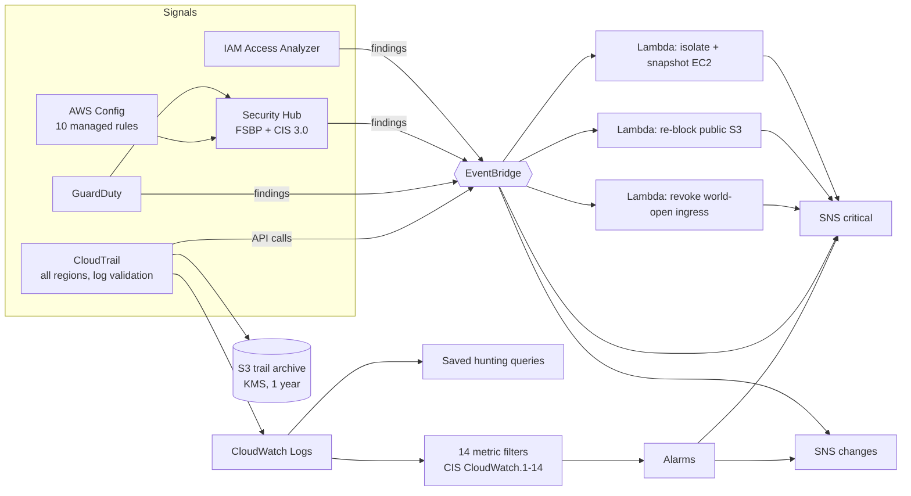

# Architecture

## Layers

| Layer | What it answers | Components |
|-------|-----------------|------------|
| Record | What happened, by whom, from where? | CloudTrail (management events, every region, global services, digest validation) to S3 and CloudWatch Logs |
| Assess | Is the account configured safely? | AWS Config history, 10 managed rules, Security Hub FSBP and CIS v3.0 standards, Access Analyzer |
| Detect | Is something bad happening right now? | 14 metric-filter detections, GuardDuty threat findings |
| Respond | What happens automatically? | EventBridge rules invoking three remediation Lambdas |
| Notify | Who needs to know, how urgently? | Two SNS channels: critical (act now) and changes (review daily) |
| Restrict | Who can touch sensitive data? | ABAC roles and a PHI KMS key for patient records |

## Design principles

1. **Detect everything, automate only the safe fixes.** Revoking a world-open
   SSH rule or re-blocking a public bucket is reversible and low-risk, so it is
   automatic. Isolating a server can take a service down, so it needs an
   explicit opt-in tag (enforced in IAM, not just code).
2. **Two alert channels.** Tampering, root use and high-severity findings go to
   a channel that should always be quiet. Routine change tracking goes
   elsewhere, so the important alerts are not ignored.
3. **Protect the protection.** Disabling CloudTrail, Config or a KMS key is
   itself a critical detection. Remediation failures alarm, and failed events
   land in dead-letter queues.
4. **Everything encrypted with keys the account controls.** One security key
   for logs and alerts, a separate PHI key that administrators cannot use to
   read records.

## Scope and limits

- Remediation Lambdas run in the home region (`us-east-2`). CloudTrail records
  every region, and the detections see all of it; extending automatic fixes to
  other regions means deploying `modules/auto-remediation` per region.
- Single account. In an AWS Organization the same modules map to a delegated
  security account: an organization trail, GuardDuty and Security Hub
  administrators, and SCPs instead of reactive fixes for the most critical rules.
